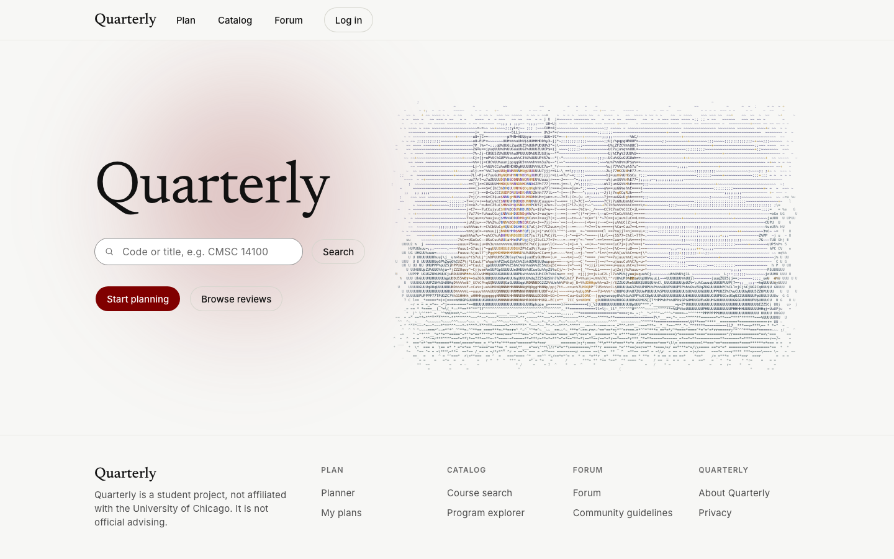
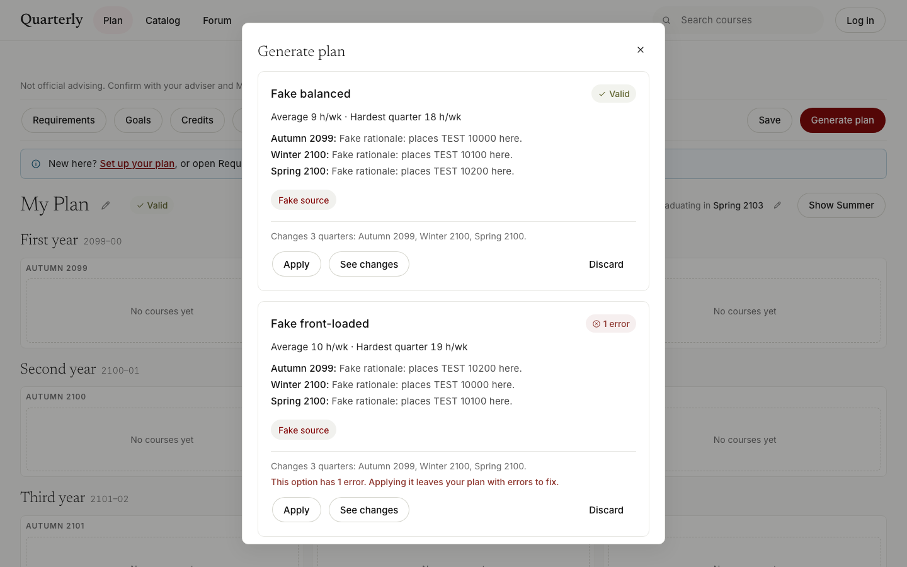
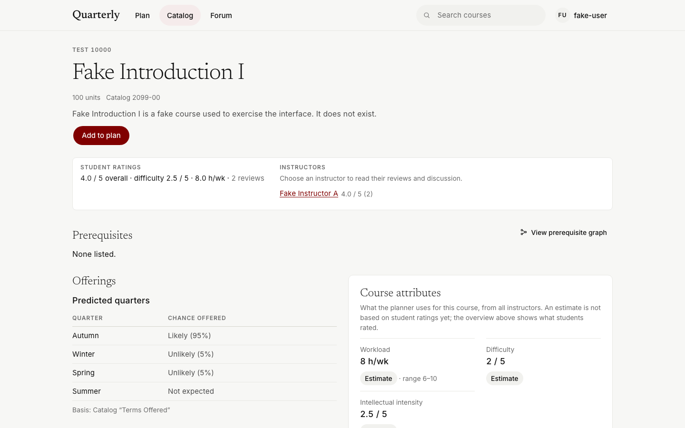
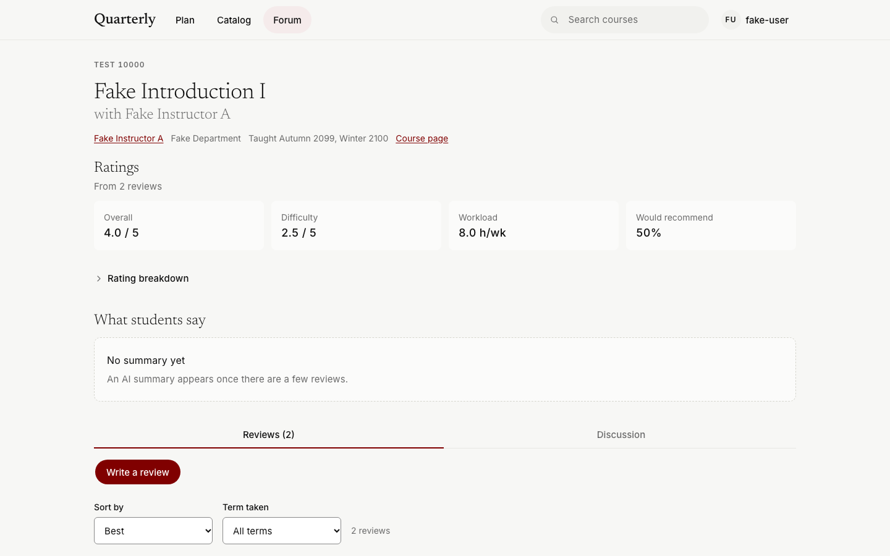

<h1 align="center">Quarterly</h1>

<p align="center"><strong>Plan four years at UChicago with plans a verifier proves, and read what students say about each course and instructor.</strong></p>

<p align="center">
  
</p>

<p align="center"><em>A student project. Not affiliated with the University of Chicago, and not official advising.</em></p>

## What Quarterly does

Quarterly has two halves of equal weight that share one course database.

- **Quarterly Planner** takes a student from "I don't know my first class" to a full, goal-aware four-year plan. An AI agent proposes plans; a deterministic verifier checks every requirement and prerequisite and issues a certificate. A plan is only called "Valid" when that certificate is accepted.
- **Quarterly Forum** gives every course × instructor pair its own page with anonymous, Reddit-style threads and structured ratings. The ratings feed each course's workload and difficulty, which the planner uses.

The rule behind it: **agents propose, code disposes.** AI drafts plans, summaries and changes; code decides what is true; a student's explicit action applies a change.

| Planner | Generate a plan |
|---|---|
|  |  |
| **Course page** | **Forum** |
|  |  |

Every page at 1440 and 390 px wide is in [`docs/screenshots/after/`](docs/screenshots/after/) (the same pages before the latest design pass are in [`before/`](docs/screenshots/before/)). Screenshots use the app's mock data.

## Status (November 2026)

A working demo, used by its owner and a few testers; a public launch comes after the catalog hand check.

- **Catalog:** 2026-27, about 1,270 courses and 11 programs (the Core; Computer Science BA, BS and three Bx/MS options; Mathematics BA and BS; Economics BA; two study-abroad civilization blocks) hand-copied from the College Catalog with verbatim source quotes, plus 152 Summer Session offerings.
- **Built:** onboarding, the four-year planner with drag and drop, live verifier and certificate checker, plan generator (OR-Tools CP-SAT), "Ask Quarterly" advisor chat, course search, course and program pages, the course × instructor forum, anonymous accounts, curator console, the animated homepage chapel.
- **AI:** off unless `LLM_LIVE=true` and a key are set (see below). Tests always use fake AI.
- **Open work:** `docs/FEEDBACK.md` (requests and their status), `docs/OPEN_QUESTIONS.md` (decisions waiting for the owner), `docs/PROGRESS.md` (what was built and when).

## Quick start

You need Docker Desktop, Python 3.12 with [`uv`](https://docs.astral.sh/uv/), and Node 22.

```bash
make install               # Python packages (uv) and the web app's node modules
make up                    # creates .env from .env.example, starts db, redis, minio, api, worker, web
make migrate && make seed  # database schema, then the 2026-27 catalog from data/seed/
make seed-forum-demo       # optional: fake instructors and forum pages for development
```

Open <http://localhost:5173> (the API is on <http://localhost:8000>). `make down` stops the stack and keeps its data.

**Turning the AI on.** In `.env`, set `ANTHROPIC_API_KEY` (and optionally `OPENROUTER_API_KEY` as the fallback) and `LLM_LIVE=true`, then `make up` again. Model choices, limits and prices live only in [`llm_routing.yaml`](llm_routing.yaml). Logged-out visitors get 3 plan generations a day per address (10 for an account), so a test run on the same machine shares that allowance; the end-to-end journeys clear the counters when they finish.

## Development

| Command | What it does |
|---|---|
| `make check` | Lint (ruff, eslint), types (mypy, tsc), Python and web unit tests, golden plans. Must pass before any change is done. |
| `make e2e` | Browser tests against mock data, then journeys A-D on the Docker stack with fake AI. **It switches the running stack to fake AI; run `make up` afterwards to get the real one back.** |
| `make screenshots` | Every page at 1440 and 390 px into `docs/screenshots/` (`SCREENSHOTS_DIR=after` picks a subfolder). |
| `make api-client` | Regenerates the OpenAPI document and the web app's TypeScript types after an API change. |
| `make help` | Lists every target. |

CI (`.github/workflows/ci.yml`) runs `make install && make check` on every push and pull request.

## Repository layout

| Path | What it is |
|---|---|
| `apps/web/` | React + TypeScript (Vite, Tailwind v4, TanStack Query, dnd-kit). `e2e/` browser tests on mock data (MSW), `e2e-stack/` journeys on the real stack. |
| `services/api/` | FastAPI app: routers, database models (SQLAlchemy, Alembic), the seed loader, agent orchestration. |
| `services/worker/` | Arq background jobs: nightly course attributes, catalog ingestion, the schedule watch, chat purge and the hourly AI spend check. |
| `services/scraper/` | Playwright scraper for the class schedule; `SCHEDULE_SCRAPER_ENABLED=false` until the University allows scraping. |
| `packages/planner_core/` | The requirements DSL, verifier, certificate checker and CP-SAT plan generator. Pure Python: no database, web framework, HTTP or LLM client. |
| `packages/llm_gateway/` | The only way code talks to a model: routing, budgets, provider fallback, fakes for tests. |
| `data/seed/2026-27/` | Hand-checked catalog YAML with a source quote for every rule. `data/golden/` holds plans that must pass or fail. |
| `prompts/` | Versioned prompts for the app's own agents. |
| `evals/` | Agent evaluations and the recorded live test (`evals/live/`). |
| `docs/` | Spec, design system, decisions, progress and review documents (map below). |
| `tools/ascii-scene/` | The converter and docs behind the homepage chapel drawing (not deployed). |
| `claude-code-prompts/` | The prompts the project was built from, in order (history; `docs/` is the current truth). |

## Documentation map

| Document | Read it for |
|---|---|
| [`CLAUDE.md`](CLAUDE.md) | Start here if you are an AI coding agent: rules, commands and where everything is. |
| [`docs/SPEC.md`](docs/SPEC.md) | The product and technical spec; [`docs/SPEC-CHANGES.md`](docs/SPEC-CHANGES.md) lists every change since. |
| [`PRODUCT.md`](PRODUCT.md) | Users, purpose, positioning and product principles. |
| [`docs/DESIGN.md`](docs/DESIGN.md) | The visual design system (colours, type, components, motion). |
| [`docs/CONTRACTS.md`](docs/CONTRACTS.md) | API endpoints and the decisions behind them. |
| [`docs/FEEDBACK.md`](docs/FEEDBACK.md) | The owner's requests and how each was resolved. |
| [`docs/OPEN_QUESTIONS.md`](docs/OPEN_QUESTIONS.md) | Decisions waiting for the owner, and catalog readings deferred until before launch. |
| [`docs/PROGRESS.md`](docs/PROGRESS.md) | What was built, step by step. |
| [`docs/DESIGN-REVIEW.md`](docs/DESIGN-REVIEW.md) | The latest full design critique and audit, with every finding's status. |
| [`docs/LIVE-TEST-REPORT.md`](docs/LIVE-TEST-REPORT.md) | The budgeted test of the AI agents against the real models. |
| [`docs/DEPLOY.md`](docs/DEPLOY.md) | Deploying to a server, backups. |

## Privacy

Accounts are anonymous: forum posts show a different pseudonym on every page. An email address is stored only in the account record and never logged; no IP addresses are logged; user dates are day-level only. Nothing a visitor's browser loads comes from another site (fonts, icons, images and the homepage weather are served by Quarterly).
