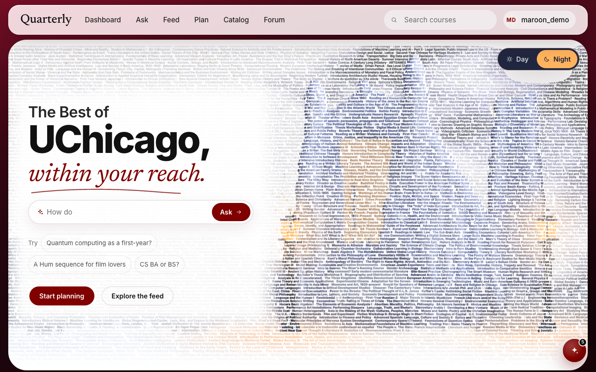
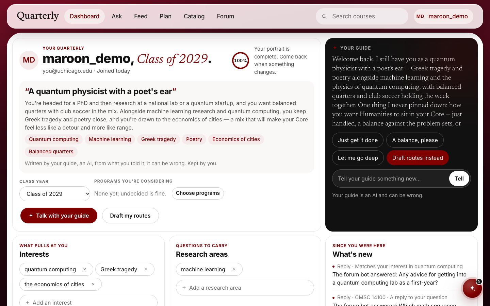
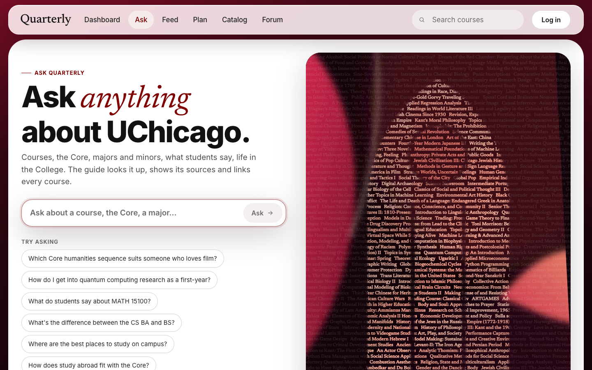
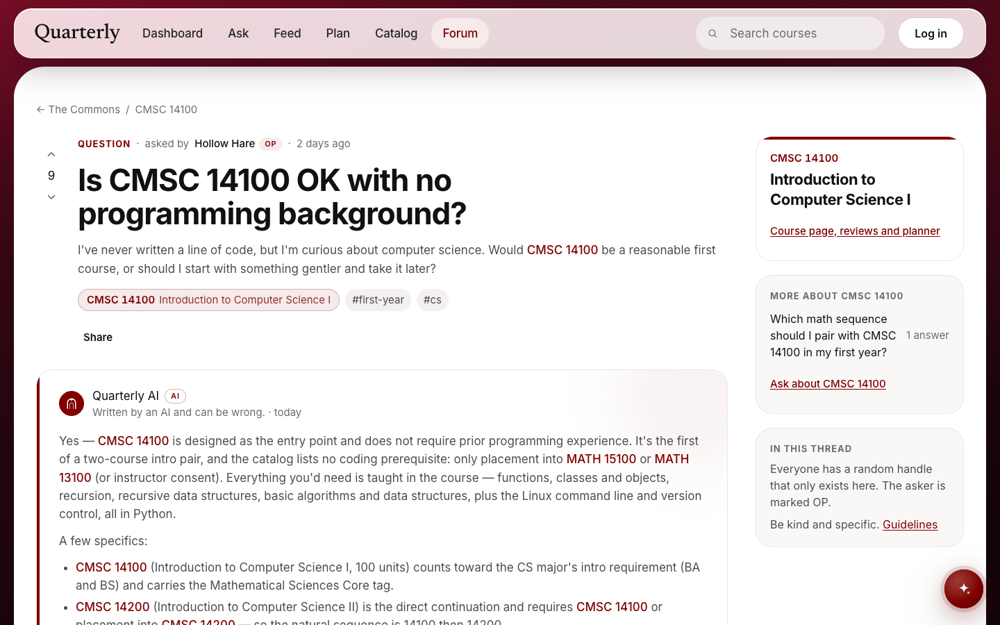
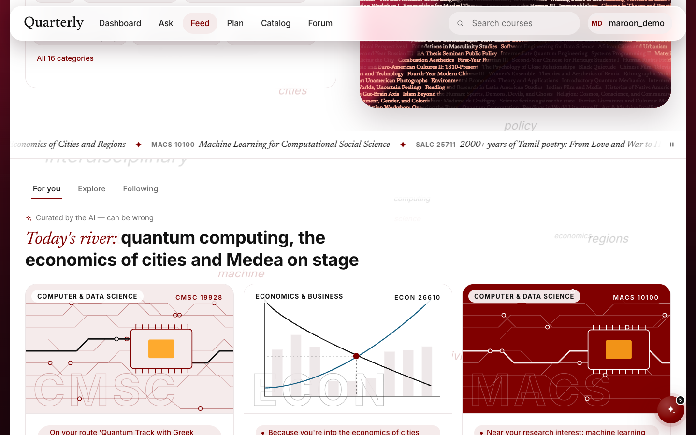
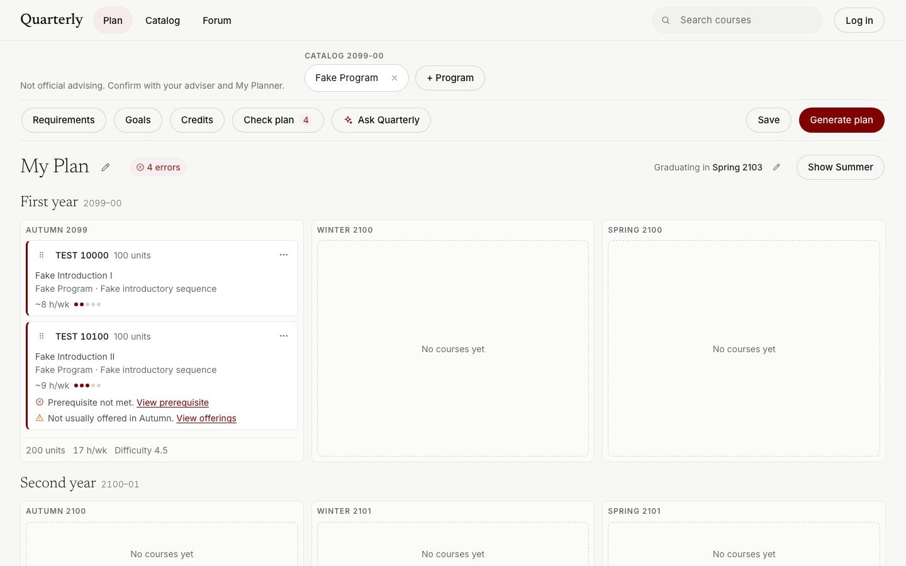

<h1 align="center">Quarterly</h1>

<p align="center"><strong>The Best of UChicago, within your reach.</strong> Ask anything about the College, plan four years with plans a verifier proves, and see what students say about every course.</p>

<p align="center">
  
</p>

<p align="center"><em>A student project. Not affiliated with the University of Chicago, and not official advising.</em></p>

## What Quarterly does

Quarterly has two halves of equal weight that share one course database. The top bar has four tabs: Dashboard, Planner, Catalog and Forum.

- **Quarterly Planner** takes a student from "I don't know my first class" to a full, goal-aware four-year plan. An AI agent proposes plans; a deterministic verifier checks every requirement and prerequisite and issues a certificate. A plan is only called "Valid" when that certificate is accepted.
- **Quarterly Forum** (`/forum`) shows course reviews and Commons discussions in one list, newest first. You can filter the list by type, course and instructor. A discussion is a question about a course. The AI writes a short first answer (at most 60 words) with its sources. Then students answer, comment, vote and accept the best reply. Logged-in students also see the reviews, and rating statistics and rankings in the left third of the page. Students write reviews on the course × instructor pages (`/instructors`), with anonymous threads and structured ratings. The ratings feed each course's workload and difficulty, which the planner uses. (Issue #20 put the reviews and the discussions in one list.)
- **Around them:**
  - **Your dashboard** (`/me`) holds your class year, interests, research areas, humanities goals, career plans and the fields you are heading toward. An interviewing guide helps you fill it in and remembers you next time.
  - **The Catalog** (`/courses`) searches every course. Before you search, it shows newly released courses, course spotlights with generated illustrations, and what students say. Logged in, every course shows its student ratings. (It replaced the feed in issue #19.)

The rule behind it: **agents propose, code disposes.** AI drafts plans, summaries and answers; code decides what is true (every course an AI names is checked against the catalog); a student's explicit action applies a change.

| Homepage at night | Your dashboard |
|---|---|
|  |  |
| **Ask Quarterly** | **The Commons** |
|  |  |
| **The feed** | **Planner** |
|  |  |

The homepage has a **Day / Night** switch. Rockefeller Chapel is drawn with the titles of 1,600 real courses (point at a title to see it, click to open it). At night the same letters paint a dark sky, falling snow and the street lamps' orange light.

The screenshots above come from the running app with a demo account; the email shown is replaced. Earlier screenshots of every page at 1440 and 390 px wide, taken before the campus companion and the latest redesign, are in [`docs/screenshots/after/`](docs/screenshots/after/) (with mock data).

## Status (November 2026)

A working demo, used by its owner and a few testers; a public launch comes after the catalog hand check.

- **Catalog:** 2026-27, 11,301 courses (about 1,270 hand-checked, with structured prerequisites; the rest imported from the College Catalog with verbatim source quotes and marked for review) and 11 programs (the Core; Computer Science BA, BS and three Bx/MS options; Mathematics BA and BS; Economics BA; two study-abroad civilization blocks), plus 152 Summer Session offerings. Every course opens its own page.
- **Built:** onboarding, the four-year planner with drag and drop, live verifier and certificate checker, plan generator (OR-Tools CP-SAT), the planner's advisor chat, course search, course and program pages, course × instructor reviews, anonymous accounts, curator console with moderation, and the homepage chapel drawn in course titles (day and night).
- **Campus companion** (branch `feature/best-of-uchicago`, see [`docs/BEST-OF-UCHICAGO-PLAN.md`](docs/BEST-OF-UCHICAGO-PLAN.md)): the dashboard with its guide, the Catalog's browse rows and the Commons. (Issue #15 removed the Ask chatbot, the floating companion and the dashboard's routes: the planner is the one place to talk to the planner agent.) Decisions for the owner are in `docs/OPEN_QUESTIONS.md` CC-1 to CC-8; the campus guide (`data/campus/guide.yaml`) must be hand-checked before launch, and the list of newly released courses (`data/catalog/new_courses.yaml`) is written by hand, with a source quote for each course.
- **AI:** off unless `LLM_LIVE=true` and a key are set (see below). Every AI feature has a version that works without it, and tests always use fake AI.
- **Open work:** `docs/FEEDBACK.md` (requests and their status), `docs/OPEN_QUESTIONS.md` (decisions waiting for the owner), `docs/PROGRESS.md` (what was built and when).

## Quick start

You need Docker Desktop, Python 3.12 with [`uv`](https://docs.astral.sh/uv/), and Node 22.

```bash
make install               # Python packages (uv) and the web app's node modules
make up                    # creates .env from .env.example, starts db, redis, minio, api, worker, web
make migrate && make seed  # database schema, then the 2026-27 catalog from data/seed/
make seed-forum-demo       # optional: fake instructors and forum pages for development
make seed-commons-demo     # optional: demo questions in the Commons (development only)
```

Open <http://localhost:5173> (the API is on <http://localhost:8000>). `make down` stops the stack and keeps its data.

**Turning the AI on.** The team reaches Claude through Teamorouter ("Teamo"), an Anthropic-compatible gateway: `.env.example` sets `ANTHROPIC_BASE_URL=https://api.teamorouter.com`. In `.env`, put the team's Teamo key in `ANTHROPIC_API_KEY` (ask Max; keys never go in git), optionally `OPENROUTER_API_KEY` as the fallback, and `LLM_LIVE=true`, then `make up` again. Every AI feature whose provider is `anthropic` in [`llm_routing.yaml`](llm_routing.yaml) then goes through Teamo; model choices, limits and prices live only in that file. To use Anthropic's own API with an Anthropic key, leave `ANTHROPIC_BASE_URL` empty. A value already exported in your shell overrides `.env`, so unset it when running the API outside Docker. Every AI feature has a daily limit per account and per address: logged-out visitors get 3 plan generations a day per address (10 for an account), 40 Ask questions (80 for an account), and so on. A test run on the same machine shares those allowances; the end-to-end journeys clear the counters when they finish.

## Development

| Command | What it does |
|---|---|
| `make check` | Lint (ruff, eslint), types (mypy, tsc), Python and web unit tests, golden plans. Must pass before any change is done. |
| `make e2e` | Browser tests against mock data, then journeys A-D on the Docker stack with fake AI. **It switches the running stack to fake AI; run `make up` afterwards to get the real one back.** |
| `make screenshots` | Every page at 1440 and 390 px into `docs/screenshots/` (`SCREENSHOTS_DIR=after` picks a subfolder). |
| `make api-client` | Regenerates the OpenAPI document and the web app's TypeScript types after an API change. |
| `make help` | Lists every target. |

CI (`.github/workflows/ci.yml`) runs `make install && make check` on every push and pull request.

## Repository layout

| Path | What it is |
|---|---|
| `apps/web/` | React + TypeScript (Vite, Tailwind v4, TanStack Query, dnd-kit). `e2e/` browser tests on mock data (MSW), `e2e-stack/` journeys on the real stack. |
| `services/api/` | FastAPI app: routers, database models (SQLAlchemy, Alembic), the seed loader, agent orchestration (`api/agents/`: the planner's agents and the dashboard's guide and the Commons bot), the Commons (`api/commons/`) and the Catalog's browse rows (`api/feed/`). |
| `services/worker/` | Arq background jobs: nightly course attributes, catalog ingestion, the schedule watch, chat purge and the hourly AI spend check. |
| `services/scraper/` | Playwright scraper for the class schedule; `SCHEDULE_SCRAPER_ENABLED=false` until the University allows scraping. |
| `packages/planner_core/` | The requirements DSL, verifier, certificate checker and CP-SAT plan generator. Pure Python: no database, web framework, HTTP or LLM client. |
| `packages/llm_gateway/` | The only way code talks to a model: routing, budgets, provider fallback, fakes for tests. |
| `data/seed/2026-27/` | Catalog YAML with a source quote for every rule (the crawl import, `zz_crawl_import.yaml`, is marked for review). `data/golden/` holds plans that must pass or fail. `data/campus/` holds the campus guide; `data/catalog/new_courses.yaml` lists newly released courses. |
| `prompts/` | Versioned prompts for the app's own agents. |
| `evals/` | Agent evaluations and the recorded live test (`evals/live/`). |
| `docs/` | Spec, design system, decisions, progress and review documents (map below). |
| `tools/course-chapel/` | Builds the homepage chapel's data (`apps/web/public/home/course-chapel.json`) from the drawing and the seed's course titles (not deployed). `tools/ascii-scene/` is the converter behind the drawing. |
| `claude-code-prompts/` | The prompts the project was built from, in order (history; `docs/` is the current truth). |

## Documentation map

| Document | Read it for |
|---|---|
| [`CLAUDE.md`](CLAUDE.md) | Start here if you are an AI coding agent: rules, commands and where everything is. |
| [`docs/SPEC.md`](docs/SPEC.md) | The product and technical spec; [`docs/SPEC-CHANGES.md`](docs/SPEC-CHANGES.md) lists every change since. |
| [`docs/BEST-OF-UCHICAGO-PLAN.md`](docs/BEST-OF-UCHICAGO-PLAN.md) | The campus companion: what was asked, the data model, the API and the pages. |
| [`PRODUCT.md`](PRODUCT.md) | Users, purpose, positioning and product principles. |
| [`docs/DESIGN.md`](docs/DESIGN.md) | The visual design system (colours, type, components, motion). |
| [`docs/CONTRACTS.md`](docs/CONTRACTS.md) | API endpoints and the decisions behind them. |
| [`docs/FEEDBACK.md`](docs/FEEDBACK.md) | The owner's requests and how each was resolved. |
| [`docs/OPEN_QUESTIONS.md`](docs/OPEN_QUESTIONS.md) | Decisions waiting for the owner, and catalog readings deferred until before launch. |
| [`docs/PROGRESS.md`](docs/PROGRESS.md) | What was built, step by step. |
| [`docs/DESIGN-REVIEW.md`](docs/DESIGN-REVIEW.md) | The latest full design critique and audit, with every finding's status. |
| [`docs/LIVE-TEST-REPORT.md`](docs/LIVE-TEST-REPORT.md) | The budgeted test of the AI agents against the real models. |
| [`docs/DEPLOY.md`](docs/DEPLOY.md) | Deploying to a server, backups. |

## Privacy

Accounts are anonymous: forum posts show a different pseudonym on every page, and Commons posts a different handle on every question. An email address is stored only in the account record and never logged; the dashboard reads it from there and never copies it. No IP addresses are logged; user dates are day-level only. Account export includes the dashboard and Commons posts, and deleting an account removes them. Nothing a visitor's browser loads comes from another site (fonts, icons and images, including the course illustrations, are made or served by Quarterly).
